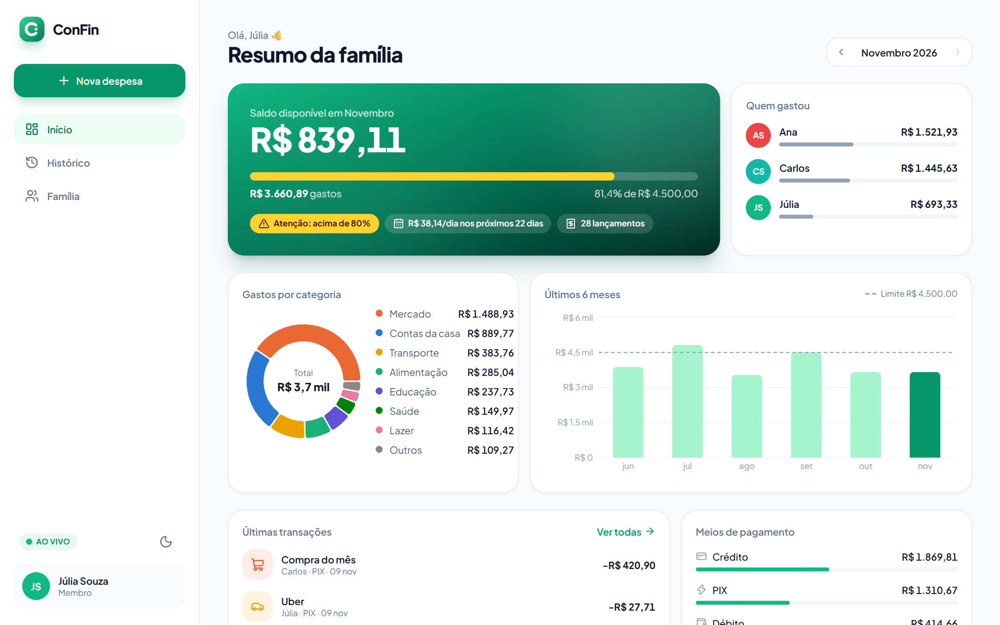
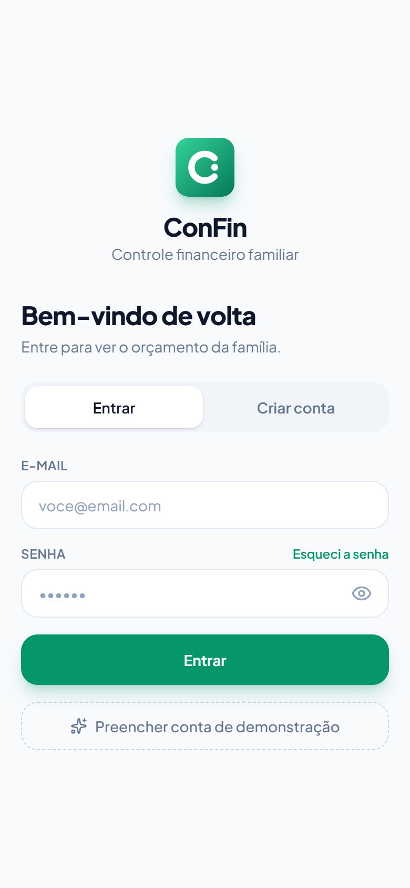
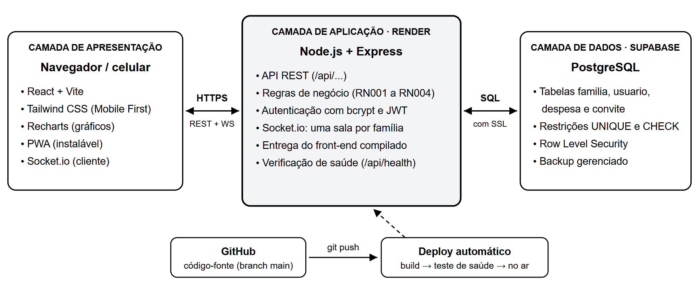

# ConFin — Family Budget Tracker

[Português](README.md) · **English**

Family members log their expenses from their phones, and the monthly budget balance updates **in real
time** for everyone. A capstone project ("Projeto Integrador II") of the Systems Analysis and Development
degree at FATEC (Brazil), from the research with families to a system deployed in the cloud.

> 🌐 **Try it:** https://confin-qetu.onrender.com — create an account, create your family and invite
> someone with the code. (Free hosting "sleeps": the first visit may take about a minute.)
>
> The app, code comments and documentation are in Brazilian Portuguese.



## The problem

In a family, each person pays a different way (credit, debit, PIX instant payments), fixed bills stay
with one person, and overspending only shows up when the credit card bill closes. In the requirements
survey (15 families plus interviews), the most common answer was: *"we only find out we overspent when
the bills arrive"*.

## The solution

- **Two-tap logging:** each member records the expense at the moment of purchase, on the phone.
- **Real time:** balance and charts update on everyone's screen without reloading (Socket.io, one "room"
  per family).
- **Budget alerts:** automatic warnings at 80% and 100% of the monthly budget.
- **Family group with roles:** the admin invites by code or e-mail and sets the limit.
- **Installable as an app (PWA)** on Android, iPhone and desktop, no app store needed.

| Login | Mobile dashboard | New expense |
|---|---|---|
|  |  |  |

## Architecture

| Layer | Technology |
|---|---|
| Front end | React 19 + Vite + Tailwind CSS 4 + Recharts, installable as a **PWA** |
| Back end | Node.js + Express 5 (REST API) |
| Real time | Socket.io (one "room" per family) |
| Database | PostgreSQL (Supabase in production, with Row Level Security) |
| Security | Passwords hashed with **bcrypt**, **JWT** authentication |
| Cloud | Render (PaaS), automatic deploy on every push to `main` |



## Software engineering

The project followed the full process of the course, documented in
[`Projeto Integrador II - Documentação de Software V3.pdf`](Projeto%20Integrador%20II%20-%20Documentação%20de%20Software%20V3.pdf):

- **Requirements** gathered through a survey (15 families) and interviews, specified as functional (RF)
  and non-functional (RNF) requirements and business rules (RN);
- **Modeling** in UML (use cases, activity, sequence), BPMN and the data model
  ([`documentacao/figuras/`](documentacao/figuras));
- **Traceability** of every requirement down to the code (see the table in the
  [Portuguese README](README.md#rastreabilidade-documentação--código));
- **Pitch deck:** [`ConFin-Pitch.pdf`](ConFin-Pitch.pdf).

## Running locally

Requires **Node.js 22+**. No Docker needed.

```bash
npm run setup                 # installs api/ and web/ dependencies
cp api/.env.example api/.env  # Windows: copy api\.env.example api\.env
npm run db:local              # terminal 1: local PostgreSQL (keep it open)
npm run db:seed               # loads the demo family
npm run dev:api               # terminal 2: API at http://localhost:3333
npm run dev:web               # terminal 3: front end at http://localhost:5173
```

Demo accounts (password `123456`): `ana@confin.app` (admin), `carlos@confin.app` and `julia@confin.app`.
Family invite code: **SOUZA1**. Quick API test, with the API running: `npm run test:smoke`.

## Team

Capstone project · Systems Analysis and Development · FATEC · 2026

- Israel Batista de Faria
- Gabriel Piva Garcia Coral
- Luis Felipe Pereira
- Mateus Rogério de Souza

Advisor: Prof. Natalie Rodrigues Alves Ferreira de Andrade.

## How it was built

The team gathered the requirements and produced the documentation and models. The implementation was
done by Mateus Rogério de Souza with **AI assistance (Claude Code)**: requirements and rules came from
the team's documentation, and the code was built and reviewed step by step, keeping every requirement
traceable in the comments and in this README.
