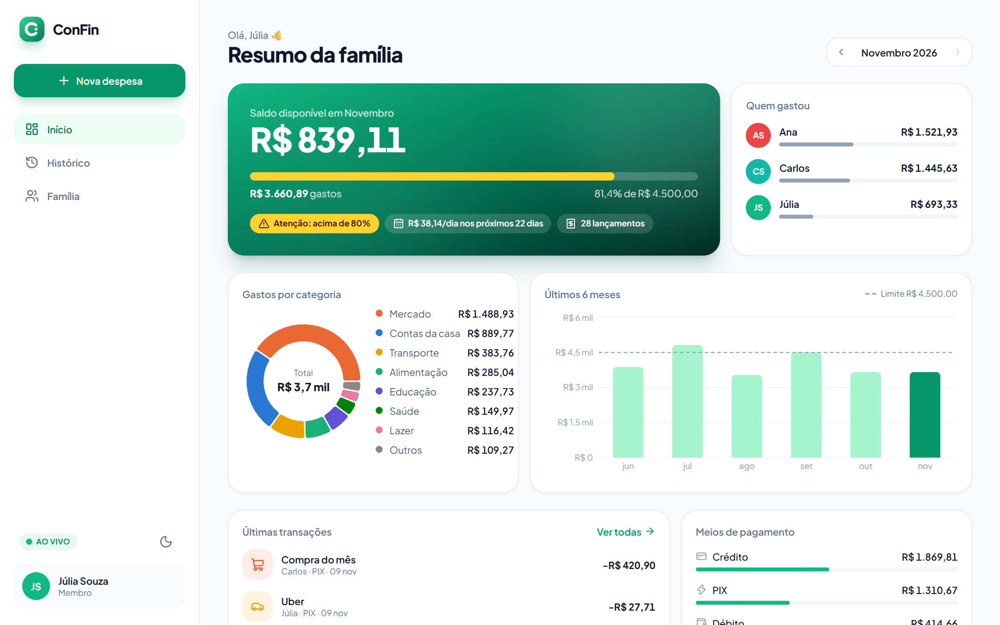
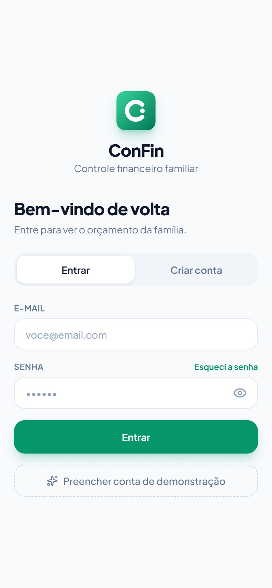
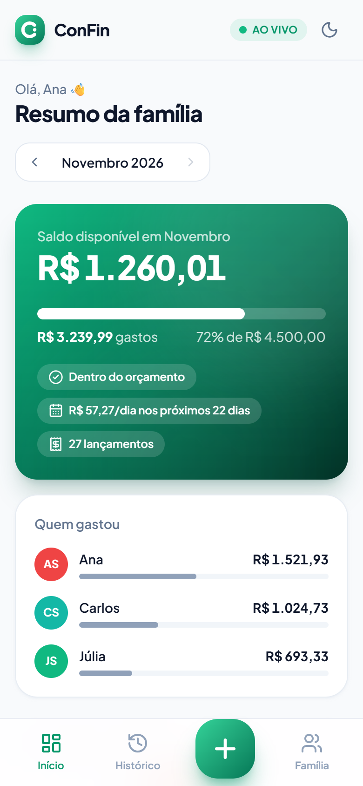
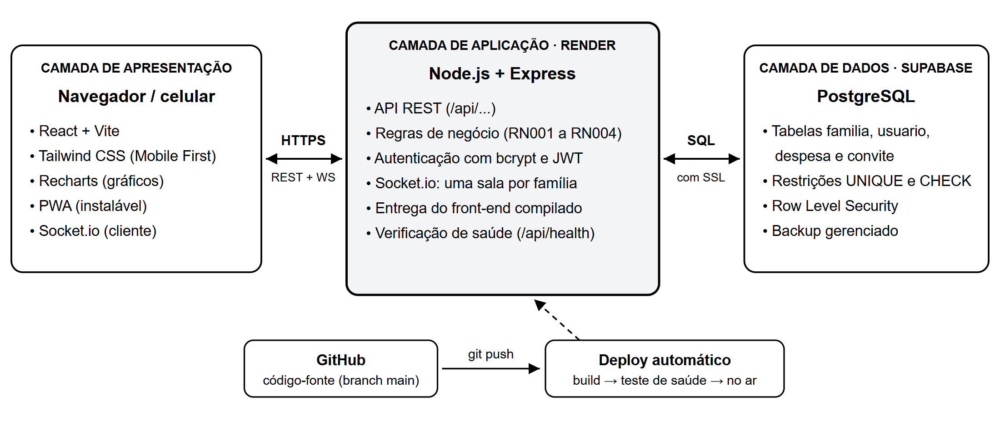

# ConFin — Controle Financeiro Familiar

**Português** · [English](README.en.md)

Os membros de uma família registram as despesas pelo celular, e o saldo do orçamento mensal é atualizado
**em tempo real** para todos. Projeto Integrador II do curso de Análise e Desenvolvimento de Sistemas
(FATEC), da pesquisa com as famílias até o sistema publicado na nuvem.

> 🌐 **Experimente:** https://confin-qetu.onrender.com — crie uma conta, crie a sua família e convide
> alguém pelo código. (O plano gratuito "hiberna": o primeiro acesso pode levar cerca de 1 minuto.)



## O problema

Numa família, cada um paga de um jeito (crédito, débito, PIX), as contas fixas ficam com uma pessoa só,
e o estouro do orçamento só aparece quando a fatura do cartão fecha. No levantamento de requisitos
(questionário com 15 famílias e entrevistas), a frase mais ouvida foi: *"só descobrimos que gastamos
demais quando as faturas chegam"*.

## A solução

- **Registro em dois toques:** cada membro lança a despesa na hora da compra, pelo celular.
- **Tempo real:** o saldo e os gráficos se atualizam na tela de todos, sem recarregar (Socket.io, uma
  "sala" por família).
- **Alertas de limite:** aviso automático em 80% e 100% do orçamento do mês.
- **Grupo familiar com papéis:** o administrador convida por código ou e-mail e define o limite.
- **Instala como aplicativo (PWA)** no Android, no iPhone e no computador, sem loja de apps.

| Login | Dashboard no celular | Nova despesa |
|---|---|---|
|  |  |  |

## Arquitetura

| Camada | Tecnologia |
|---|---|
| Front-end | React 19 + Vite + Tailwind CSS 4 + Recharts, instalável como **PWA** |
| Back-end | Node.js + Express 5 (API REST) |
| Tempo real | Socket.io (uma "sala" por família) |
| Banco de dados | PostgreSQL (Supabase em produção, com Row Level Security) |
| Segurança | Senhas com **bcrypt**, autenticação **JWT** |
| Nuvem | Render (PaaS), deploy automático a cada push na `main` |



## Engenharia de software

O projeto seguiu o processo completo da disciplina, com a documentação em
[`Projeto Integrador II - Documentação de Software V3.pdf`](Projeto%20Integrador%20II%20-%20Documentação%20de%20Software%20V3.pdf)
(padrão ABNT):

- **Requisitos** levantados com questionário (15 famílias) e entrevistas, especificados em requisitos
  funcionais (RF), não funcionais (RNF) e regras de negócio (RN);
- **Modelagem** em UML (casos de uso, atividades, sequência), BPMN e modelo de dados
  ([`documentacao/figuras/`](documentacao/figuras));
- **Rastreabilidade** de cada requisito até o código (tabela abaixo);
- **Pitch** de apresentação: [`ConFin-Pitch.pdf`](ConFin-Pitch.pdf).

### Rastreabilidade (documentação → código)

| Requisito | Onde está |
|---|---|
| RF001 Cadastrar usuário | `POST /api/auth/register` — [api/src/routes/auth.js](api/src/routes/auth.js) |
| RF002 Registrar despesa | `POST /api/despesas` — [api/src/routes/despesas.js](api/src/routes/despesas.js) |
| RF003 Grupo familiar | `/api/familias` (criar, código, convite por e-mail, remover) — [api/src/routes/familias.js](api/src/routes/familias.js) |
| RF004 Dashboard em tempo real | `GET /api/despesas/resumo` + Socket.io — [api/src/resumo.js](api/src/resumo.js), [web/src/pages/Dashboard.jsx](web/src/pages/Dashboard.jsx) |
| RN001 E-mail único | `UNIQUE` em `usuario.email` + verificação no cadastro |
| RN002 Valor positivo | `CHECK (valor > 0)` + validação na API e no formulário |
| RN003 Só o admin gerencia membros e limite | middleware `exigirAdmin` |
| RN004 Alertas em 80% e 100% do limite | `nivelAlerta()` em [api/src/resumo.js](api/src/resumo.js) |
| RNF002 Mobile First | Layout com menu inferior e botão central "+" |
| RNF003 Hash de senha | bcrypt (custo 10) |
| UC002 Cenário alternativo | Passar do limite é permitido, mas gera alerta visual |

## Como rodar localmente

Pré-requisito: **Node.js 22 ou superior**. Não precisa de Docker.

```bash
npm run setup                 # instala as dependências da api/ e do web/
cp api/.env.example api/.env  # Windows: copy api\.env.example api\.env
npm run db:local              # terminal 1: PostgreSQL local (deixe aberto)
npm run db:seed               # popula a família de demonstração
npm run dev:api               # terminal 2: API em http://localhost:3333
npm run dev:web               # terminal 3: front-end em http://localhost:5173
```

Contas de demonstração (senha `123456`): `ana@confin.app` (administradora), `carlos@confin.app` e
`julia@confin.app`. Código de convite da família: **SOUZA1**.

Teste rápido da API, com ela rodando: `npm run test:smoke` (login, RN001, RN002, permissões e o
cálculo do saldo).

### Estrutura

```
api/
  db/schema.sql          Modelo relacional (familia, usuario, despesa, convite)
  src/server.js          Express + Socket.io; em produção também serve o front
  src/auth.js            JWT e middlewares de permissão
  src/resumo.js          Lógica central do saldo
  src/routes/            auth, familias, despesas
  scripts/               banco local, seed e teste rápido
web/
  src/pages/             Login, Onboarding, Dashboard, Histórico, Família
  src/components/        Layout (menu), formulário de despesa, itens de UI
  src/context/           Sessão, notificações e tempo real
```

### Endpoints

| Método | Rota | Descrição |
|---|---|---|
| POST | `/api/auth/register` · `/api/auth/login` | Cadastro e login (retorna JWT) |
| GET | `/api/auth/me` | Usuário logado |
| POST | `/api/familias` · `/api/familias/entrar` | Criar família / entrar com código |
| GET · PATCH | `/api/familias/minha` | Dados da família / alterar nome e limite (admin) |
| POST · DELETE | `/api/familias/minha/convites` | Convidar por e-mail / cancelar (admin) |
| DELETE | `/api/familias/minha/membros/:id` | Remover membro (admin) |
| GET · POST | `/api/despesas` | Listar (filtros: `mes`, `categoria`, `usuario_id`, `busca`) / registrar |
| PUT · DELETE | `/api/despesas/:id` | Editar / excluir (autor ou admin) |
| GET | `/api/despesas/resumo?mes=AAAA-MM` | Dados do dashboard |

## Equipe

Projeto Integrador II · Análise e Desenvolvimento de Sistemas · FATEC · 2026

- Israel Batista de Faria
- Gabriel Piva Garcia Coral
- Luis Felipe Pereira
- Mateus Rogério de Souza

Orientadora: Prof.ª Natalie Rodrigues Alves Ferreira de Andrade.

## Como foi feito

A equipe fez o levantamento de requisitos, a documentação e a modelagem. A implementação foi feita por
Mateus Rogério de Souza com **assistência de IA (Claude Code)**: os requisitos e as regras vieram da
documentação da equipe, e o código foi construído e revisado etapa por etapa, com a rastreabilidade de
cada requisito mantida nos comentários e neste README.
